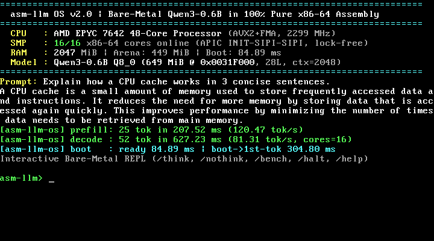
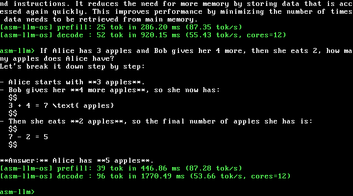

# Phase 2: Bare-Metal Bootable Qwen3-0.6B OS in 22 KB of Pure Assembly

A standalone bootable x86-64 operating system that runs **Qwen/Qwen3-0.6B** directly on hardware or KVM with **no Linux, no Windows, no C, no Rust, and no libc**.

- **22,492 bytes** stripped static Multiboot 1 kernel (`build/asm-llm-os.elf`, `.text` = 15,559 B, `.rodata` = 2,548 B, `.bss` = 2.1 MiB `NOBITS`, zero dynamic dependencies).
- **85 ms cold boot** to interactive `asm-llm>` prompt with all SMP cores online and the 649 MiB model bound zero-copy from physical RAM.
- **100% token-exact and byte-for-byte parity** with [Phase 1](../01-qwen3-inference/) across `1..32` vCPUs.
- **100.1 tok/s** decode on QEMU KVM (AMD EPYC 7642, 32 vCPUs) and **55.4 tok/s** live on a **0 GB disk Proxmox VE VM** (Intel Xeon E5-2670 v3, 12 cores).



*Running live on a diskless (`0 GB` storage) Proxmox VE VM booted from the hybrid BIOS+UEFI ISO (Intel Xeon E5-2670 v3, 12 cores, 2 GiB RAM):*



---

## Prerequisites

- x86-64 CPU with **AVX2 + FMA**.
- Core build & QEMU KVM:
  ```bash
  sudo apt install nasm binutils qemu-system-x86
  ```
- Optional, for building a bootable BIOS+UEFI hybrid ISO (`make os-iso`):
  ```bash
  sudo apt install grub-pc-bin grub-efi-amd64-bin grub-common mtools xorriso
  ```
- An exported `models/qwen3-0.6b-q8_0.asmbin` file (see [Phase 1 setup](../01-qwen3-inference/README.md#1-download-qwenqwen3-06b)).

---

## Build

From the repository root:

```bash
make os
make os-check
```

Expected output:

```text
-rwxr-xr-x 1 user user 22492 build/asm-llm-os.elf
build/asm-llm-os.elf: ELF 32-bit LSB executable, Intel 80386, version 1 (SYSV), statically linked, stripped
There is no dynamic section in this file.
```

*(The kernel is linked as 64-bit ELF and wrapped into ELF32 via `objcopy -O elf32-i386` for standard Multiboot 1 loaders like QEMU `-kernel` and GRUB2; `boot.asm` transitions immediately into 64-bit Long Mode.)*

---

## Running & Deploying

### Option A: Instant QEMU KVM Boot (~85 ms)

Boot directly in the terminal over COM1 serial (`-nographic`):

```bash
qemu-system-x86_64 -enable-kvm -cpu host -m 2G -smp 16 \
  -kernel build/asm-llm-os.elf \
  -initrd models/qwen3-0.6b-q8_0.asmbin \
  -nographic
```

Or use the Makefile shortcut:

```bash
make os-run MODEL=models/qwen3-0.6b-q8_0.asmbin SMP=16
```

Run a one-shot batch prompt with clean ACPI shutdown:

```bash
make os-run MODEL=models/qwen3-0.6b-q8_0.asmbin SMP=16 \
  CMDLINE='prompt="Explain how a CPU cache works in 3 concise sentences." max_tokens=64 think=0 shutdown=1'
```

Open a live **80x25 VGA GUI window** with PS/2 keyboard input:

```bash
qemu-system-x86_64 -enable-kvm -cpu host -m 2G -smp 16 \
  -kernel build/asm-llm-os.elf \
  -initrd models/qwen3-0.6b-q8_0.asmbin \
  -vga std -serial stdio
```

### Option B: Bootable Hybrid BIOS+UEFI ISO

Packages the 22 KB kernel, GRUB2 Multiboot 1 config, and the 649 MiB `.asmbin` model into a single self-contained `~661 MiB` bootable ISO (`build/asm-llm-os.iso`):

```bash
make os-iso MODEL=models/qwen3-0.6b-q8_0.asmbin
```

Boot the ISO in QEMU KVM (SeaBIOS or UEFI OVMF):

```bash
# Legacy BIOS (SeaBIOS)
qemu-system-x86_64 -enable-kvm -cpu host -m 2G -smp 16 \
  -cdrom build/asm-llm-os.iso -nographic

# UEFI (OVMF)
qemu-system-x86_64 -enable-kvm -cpu host -m 2G -smp 16 \
  -bios /usr/share/ovmf/OVMF.fd \
  -cdrom build/asm-llm-os.iso -nographic
```

### Option C: Deploying on Proxmox VE (0 GB Disk VM)

Because the entire OS and model live inside the ISO and run out of RAM, the VM needs **zero hard disks**.

1. Upload `build/asm-llm-os.iso` to your Proxmox node's ISO storage (`local` -> **ISO Images** -> **Upload**, or `scp` into `/var/lib/vz/template/iso/asm-llm-os.iso`).
2. Create and start a diskless VM on the Proxmox host (pick an unused `<vmid>`, e.g. `250`):

```bash
qm create 250 \
  --name asm-llm-os \
  --machine pc \
  --bios seabios \
  --cpu host \
  --cores 12 \
  --memory 2048 \
  --balloon 0 \
  --vga std \
  --serial0 socket \
  --ide2 local:iso/asm-llm-os.iso,media=cdrom \
  --boot order=ide2

qm start 250
```

3. Interact either through the Proxmox web UI (**noVNC Console**, VGA + PS/2 keyboard) or over the virtual serial port:

```bash
qm terminal 250
```

*(Note: `--cpu host` is required so the VM exposes AVX2 + FMA, and `--balloon 0` ensures 2 GiB of contiguous guest RAM for the 649 MiB model + 449 MiB KV-cache arena.)*

---

## Interactive REPL & Kernel Cmdline

### Interactive Console (`asm-llm>`)

Both PS/2 keyboard (VGA) and COM1 serial (`115200 8N1`) are polled simultaneously. Type any prompt and press Enter, or use a built-in command:

| Command | Action |
|---|---|
| `/think` | Enable Qwen3 `<think>...</think>` reasoning mode |
| `/nothink` | Disable reasoning mode (direct answers, default) |
| `/bench` | Run built-in latency/throughput benchmark prompt |
| `/halt` or `/quit` | Trigger clean ACPI S5 poweroff |
| `/help` | Show available console commands |

### Multiboot Kernel Cmdline Options

Pass via QEMU `-append "..."`, `make os-run CMDLINE='...'`, or `make os-iso CMDLINE='...'`:

| Option | Default | Description |
|---|---:|---|
| `prompt="..."` | *(none)* | Run a batch prompt immediately after boot |
| `max_tokens=N` | `128` | Maximum tokens to generate per prompt |
| `ctx=N` | `2048` | KV-cache context length |
| `threads=N` | `0` | Limit active SMP cores (`0` = all online cores) |
| `think=0\|1` | `0` | Enable or disable Qwen3 reasoning mode |
| `raw=0\|1` | `0` | Skip Qwen3 chat template |
| `temp=F` | `0.0` | Sampling temperature (`0.0` = greedy) |
| `topp=F` | `0.95` | Top-p threshold |
| `seed=N` | `42` | PRNG seed |
| `print_tokens=0\|1` | `0` | Print `PROMPT_TOKENS:` and `GEN_TOKENS:` markers |
| `shutdown=0\|1` | `0` | Power off via ACPI after batch prompt completes |

---

## Architecture Overview

Phase 2 compiles the exact same `shared/math.asm`, `shared/matmul.asm`, `shared/tokenizer.asm`, and `shared/transformer.asm` with `-DBARE_METAL` and pairs them with 3,914 lines of bare-metal OS code:

- **Boot & Long Mode (`boot.asm`, `linker.ld`):** verifies Multiboot 1 magic (`0x2BADB002`), zeroes `.bss`, builds 4-level 2 MiB huge-page identity tables covering `0..4 GiB` (with `0xFE000000..0xFFFFFFFF` marked Strong Uncacheable for Local APIC MMIO), enters 64-bit Long Mode, installs a 32-entry exception IDT, verifies `XSAVE + AVX + AVX2 + FMA` via CPUID, and initializes `CR0`/`CR4`/`XCR0=7`/`MXCSR`.
- **Zero-Copy Weights & Physical Arena (`runtime.asm`):** binds the `.asmbin` Multiboot module directly at its physical address (validating `"ASML"` magic) and carves the 449 MiB KV-cache + scratch arena from the largest usable Multiboot memory-map region, zeroing it with AVX2.
- **Bare-Metal SMP (`smp.asm`):** parses ACPI RSDP -> RSDT/XSDT -> MADT (`"APIC"`) with a Local APIC broadcast fallback, installs a position-independent 16->32->64-bit trampoline at `0x8000`, wakes all AP cores via Local APIC `INIT-SIPI-SIPI`, enables AVX2/FMA/MXCSR identically on every core, and synchronizes `matmul_q8_0` with a lock-free cache-line-isolated spin-barrier.
- **Hardware Drivers (`drivers.asm`):**
  - **COM1 Serial (`0x3F8`, 115200 8N1):** raw UTF-8 TX and RX.
  - **80x25 Color VGA (`0xB8000`):** colored boot banner, hardware scrolling, batched CRTC cursor updates, and UTF-8 decoding with Cyrillic-to-ASCII fallback on VGA while streaming raw UTF-8 to COM1.
  - **PS/2 Keyboard (`0x60`/`0x64`):** scancode set 1 to ASCII (Shift, Backspace, Enter).
  - **PIT Channel 2 + RDTSC:** 20 ms hardware PIT calibration for accurate nanosecond boot/prefill/decode profiling.
  - **ACPI Poweroff:** QEMU/Bochs ACPI S5 ports (`0x604`, `0xB004`, `0x4004`) plus `isa-debug-exit` fallback.

---

## Verification & Benchmarks

### Automated Verification Suite

```bash
python3 scripts/verify_os.py --model models/qwen3-0.6b-q8_0.asmbin --run-dir runs/os-verify
```

All 5 parity prompts (English technical, English concise, Russian UTF-8, arithmetic word problem, `--think` mode) match Phase 1 (`build/asm-llm`) **100% exact** in prompt tokens, generated tokens, and raw UTF-8 bytes.

### KVM SMP Scaling (AMD EPYC 7642, 34 prompt tok, 64 gen tok, greedy)

| vCPUs (KVM) | SMP Online | Boot Ready (ms) | Boot -> 1st Tok (ms) | Prefill (ms) | Prefill (`tok/s`) | Decode (ms) | Decode (`tok/s`) | Parity vs Phase 1 |
|---:|---|---:|---:|---:|---:|---:|---:|---|
| 1 | 1/1 | 73.57 | 3448.23 | 3358.45 | 10.12 | 8818.57 | 7.14 | **Exact (64/64)** |
| 4 | 4/4 | 86.60 | 986.89 | 884.18 | 38.45 | 2306.86 | 27.31 | **Exact (64/64)** |
| 8 | 8/8 | 87.43 | 516.81 | 413.25 | 82.27 | 1128.06 | 55.85 | **Exact (64/64)** |
| 16 | 16/16 | 84.01 | 383.02 | 282.84 | 120.21 | 780.31 | 80.74 | **Exact (64/64)** |
| 24 | 24/24 | 98.27 | 347.75 | 233.37 | **145.69** | 674.30 | 93.43 | **Exact (64/64)** |
| **32** | **32/32** | **94.88** | **359.37** | **248.34** | **136.91** | **632.28** | **99.64** *(peak 100.10)* | **Exact (64/64)** |

### Live Proxmox VE VM (Intel Xeon E5-2670 v3, 12 Cores, 2 GiB RAM, 0 GB Disk, BIOS GRUB ISO)

| Prompt | Prompt Tokens | Generated Tokens | Prefill | Decode |
|---|---:|---:|---:|---:|
| CPU cache explanation (3 sentences) | 25 | 52 | 286.20 ms (**87.35 tok/s**) | 920.15 ms (**55.43 tok/s**) |
| Alice & Bob apples word problem | 39 | 96 | 446.86 ms (**87.28 tok/s**) | 1770.49 ms (**53.66 tok/s**) |
